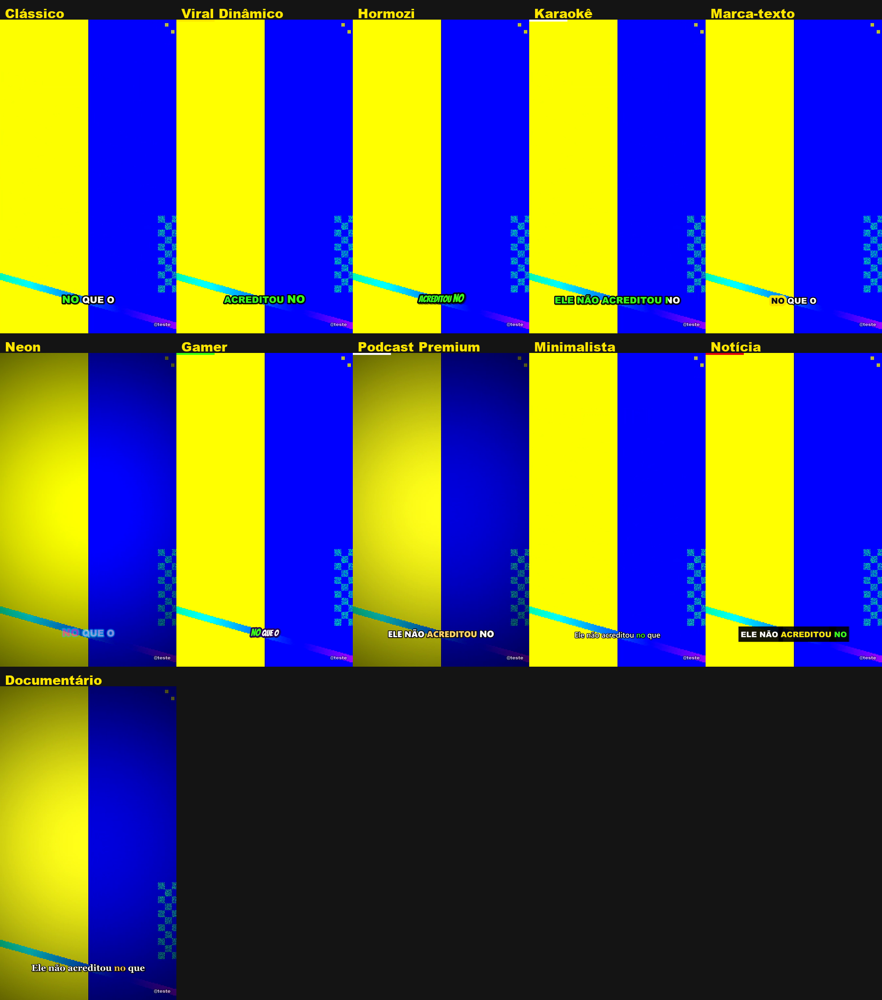

# ✂ Gerador de Cortes 9:16

**Transforma lives e vídeos longos em cortes verticais prontos para TikTok, YouTube Shorts e Reels —
com inteligência artificial, edição de nível profissional e aprendizado a partir dos resultados do seu
canal.** Roda no seu PC (Windows), usando a sua própria assinatura de IA.


---

## O que ele faz

Você aponta uma fonte — link do YouTube ou da Twitch, uma live que o robô gravou ou um vídeo do
computador — e o sistema entrega o corte pronto: enquadrado em 9:16, com legenda animada, pergunta de
gancho, título, hashtags, capa e trilha, já organizado na galeria para revisar e postar.

| Etapa | O que acontece |
|---|---|
| **Achar o momento** | Usa o gráfico de "mais repetidos" do YouTube, os picos do chat e a energia do áudio; a IA escolhe entre os candidatos e dá nota a cada um. Em live, um "termômetro" dispara o corte em tempo real. |
| **Limpar o trecho** | Tira silêncios, vícios de linguagem ("é…", "tipo", "né") e pontas fracas, sem começar nem terminar no meio da frase. |
| **Entender o conteúdo** | Transcreve com Whisper (com o glossário de nomes do canal) e, numa chamada só, a IA corrige a legenda e escreve resumo, pergunta, alternativas, título, chamada para comentários, hashtags, nota e motivo. |
| **Conferir a IA** | Um juiz local (sem custo) reprova pergunta genérica, sem ligação com o trecho ou com número inventado, e troca por uma alternativa melhor. |
| **Editar** | 11 templates (Hormozi, Karaokê, Notícia, Neon…), zoom nas palavras-chave, câmera que segue o rosto, layouts de podcast e jogo, música de fundo que abaixa quando alguém fala, final em loop ou com chamada, zona segura por plataforma. |
| **Entregar** | Render 9:16 com revisão técnica, capa, legenda `.srt`, texto do post e versões A/B e em espanhol (opcionais). |
| **Aprender** | Lê as views do YouTube e do TikTok, compara templates, perguntas e horários, e devolve esse aprendizado para a IA e para a escolha automática de template. |



## Como funciona

```mermaid
flowchart LR
    A[Fonte<br/>YouTube, Twitch, live gravada ou vídeo do PC] --> B[Achar momentos<br/>replays, chat, áudio + IA]
    B --> C[Baixar só o trecho]
    C --> D[Limpar<br/>silêncios, vícios, pontas]
    D --> E[Transcrever<br/>Whisper + glossário]
    E --> F[IA<br/>pergunta, título, nota, gancho]
    F --> G[Juiz local<br/>confere e corrige]
    G --> H[Edição<br/>template, legenda, zoom, trilha]
    H --> I[Render 9:16<br/>capa e revisão técnica]
    I --> J[Galeria PC/celular<br/>revisar e postar]
    J --> K[Resultados<br/>views e retenção]
    K -. aprendizado .-> F
```



## Destaques

- **IA econômica e confiável** — chamada enxuta (cerca de 5 mil tokens por corte, contra 42 mil na
  versão anterior), três níveis de qualidade, reserva automática quando uma IA bate o limite, conserto
  de resposta com defeito e painel de uso.
- **Fidelidade** — a transcrição vai para a IA marcada como material (não como instrução), e o juiz
  local barra números inventados e perguntas genéricas.
- **Aprende com o uso** — glossário de nomes por canal (corrigidos pela IA ou por você), gosto do dono
  (as perguntas que você troca) e desempenho real de cada template.
- **Segurança de direitos** — aviso de música de fundo antes de postar, crédito da fonte no post e
  revisão humana antes de publicar.
- **Funciona sem nuvem** — tudo roda no PC; a galeria abre no celular pela rede de casa, com PIN.
- **Recuperável** — fila durável, retomada sem pagar a IA de novo e atualização protegida por git.

## Requisitos

- Windows 10 ou 11 (processador comum serve; placa de vídeo acelera o render quando existe).
- Python 3.12 e ffmpeg (o instalador cuida dos dois).
- Uma IA: **Claude Code** (assinatura Claude), **Codex** (conta do ChatGPT), **Gemini** (chave grátis
  do Google AI Studio ou login) ou **Ollama** (local, grátis). Também funciona sem IA, com qualidade menor.

## Instalação

```bat
INSTALAR.bat
```

Em qualquer PC com Windows 10/11, mesmo sem nada instalado: garante o Python 3.12 (separado de outros
Pythons do PC) e chama o **doutor de instalação** (`doutor.py`), que examina o PC e instala o que falta:
ambiente `.venv`, bibliotecas, Visual C++, ffmpeg e PATH. Quando um passo falha, ele lê o erro e tenta
outro conserto; se tiver uma IA, ela ajuda a escolher, mas só entre consertos seguros pré-definidos.
Depois abra o programa, vá em **🔑 Contas & IA** e conecte a sua conta de IA (uma vez só). Detalhes em
[docs/MANUAL.md](docs/MANUAL.md).

Só ver o que falta, sem instalar: `EXAMINAR-PC.bat`. Instalação manual, para quem prefere:

```bat
py -3.12 doutor.py --consertar
interface.bat
```

## Uso

| Jeito | Como |
|---|---|
| **Interface** | `interface.bat` — abas Corte, Tendências, Automático, Visual, Galeria, Resultados e Contas & IA. |
| **Robô** | `monitor.bat` — vigia canais e lives, grava, detecta os picos e corta sozinho. |
| **Linha de comando** | `python cortes.py "LINK" --inicio 12:30 --fim 13:20` |
| **Celular** | Galeria → 📱 Celular: assistir, aprovar e postar pelo navegador do celular. |

## Inteligência artificial

O nível de qualidade fica em **Contas & IA → Qualidade da IA**. Medido num trecho real de 66 segundos:

| Nível | Modelos | Custo equivalente por corte* | Tempo |
|---|---|---|---|
| Econômica | Haiku em tudo | ~US$ 0,003 | ~21 s |
| **Equilibrada** (padrão) | Sonnet nos cortes e na escolha de momentos, Haiku no resto | ~US$ 0,024 a 0,038 | 10 a 24 s |
| Máxima | Opus nos cortes, Sonnet no resto | maior | — |

\* Valor de tabela da API; na assinatura, indica quanto do seu limite de uso é consumido. O painel
**📊 Uso da IA** mostra o gasto real dos últimos 7 dias.

## Estrutura do projeto

```text
cortes.py            orquestra o corte (download → limpeza → transcrição → IA → edição → render)
ia_cortes.py         IA dos cortes: provedores, pedido, validação, lote
ia_motor.py          motor de IA: JSON tolerante, saúde dos provedores, uso, modelos por tarefa
ia_juiz.py           juiz local das perguntas, títulos e hashtags
ia_aprende.py        glossário de nomes por canal e gosto do dono
render.py            render final 9:16 com ffmpeg
templates_edicao.py  os 11 templates de edição
legendas.py          legendas .ass (animadas) e .srt
faixas.py            faixa, foto do topo, selos e emojis
acabamento.py        zoom nas palavras-chave, zona segura, abertura, final, capa
audio_musica.py      detector de música de fundo
musica.py            trilha de fundo com ducking
momentos.py          achar os melhores momentos de um vídeo
monitor.py           o robô (lives, canais, fila)
interface.py         a interface gráfica
docs/                manual, proposta, arquitetura e guias
test_*.py            testes automáticos
```

O mapa completo está em [docs/ARQUITETURA.md](docs/ARQUITETURA.md).

## Testes

```bat
set PYTHONUTF8=1
python -m unittest discover -p "test_*.py"
```

167 testes cobrem o pipeline com ffmpeg real (sem internet e sem chamar IA), o motor de IA, o juiz, o
aprendizado, os templates, a galeria e o atualizador.

## Atualização

A pasta do programa é um repositório git. O botão de versão (ou `git pull`) traz a versão nova sem
sobrescrever nada: se houver alteração local não salva, a atualização é recusada.

## Privacidade e segurança

- Configurações, contas, cortes, gravações e números ficam só no PC e **não vão para o repositório**
  (`.gitignore`).
- A chave do Gemini fica criptografada pelo Windows (DPAPI): só a sua conta, neste PC, consegue abrir.
- As chamadas de IA usam a sua assinatura, sem chave de API, e não gravam sessão no histórico do Claude
  Code.
- O sistema sugere; **você revisa e decide o que publica**. Prefira canais que permitem cortes.

## Documentação

- [Manual de uso](docs/MANUAL.md)
- [Proposta do projeto](docs/PROPOSTA.md)
- [Arquitetura](docs/ARQUITETURA.md)
- [Histórico de versões](CHANGELOG.md)
- [Conectar o YouTube](docs/TUTORIAL-YOUTUBE.md) · [Funções avançadas](docs/GUIA-FUNCOES-AVANCADAS.md)

## Licença

Projeto pessoal — todos os direitos reservados ao autor. A fonte Bangers (`fontes/`) e o modelo de
detecção de rosto YuNet (`modelos/`) têm licenças próprias, incluídas nas respectivas pastas.
