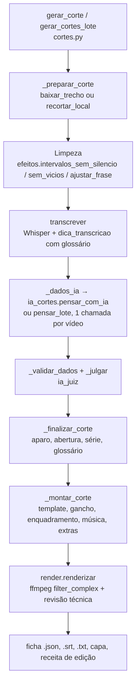

# Arquitetura

Visão técnica do Gerador de Cortes 9:16 (versão 3.14): fluxo, módulos, decisões de projeto e como testar.

## Fluxo de um corte



O robô (`monitor.py`) alimenta o mesmo fluxo a partir de lives e canais, com uma fila durável
(`fila_tarefas.py`) e checkpoints (`conclusao_tarefas.py`) que evitam refazer trabalho e pagar a IA
duas vezes.

## Mapa de módulos

| Camada | Módulo | Responsabilidade |
|---|---|---|
| Orquestração | `cortes.py` | Configuração (`config.json` e perfis), download, limpeza, transcrição e montagem do corte. |
| | `monitor.py` | Robô: vigia canais e lives, grava, dispara cortes e postagens. |
| | `fila_tarefas.py`, `conclusao_tarefas.py` | Fila durável e checkpoint de saída. |
| Seleção | `momentos.py`, `detector.py`, `chat_vod.py`, `tendencias.py` | Melhores momentos, termômetro de live, chat de VODs, radar de tendências. |
| IA | `ia_motor.py` | Motor genérico: JSON tolerante, saúde dos provedores, registro de uso, modelos por tarefa. |
| | `ia_cortes.py` | Provedores (Claude, Codex, Gemini, Ollama), pedido de cada corte, validação, lote. |
| | `ia_juiz.py` | Juiz local de perguntas, títulos e hashtags. |
| | `ia_aprende.py` | Glossário de nomes por canal e gosto do dono. |
| | `inteligencia_editorial.py`, `editorial.py`, `calibracao.py` | Avaliação editorial com evidências, Central de edição, autonomia calibrada. |
| Edição | `templates_edicao.py` | Os 11 templates (legenda + efeitos). |
| | `legendas.py`, `faixas.py`, `acabamento.py` | Legendas `.ass`/`.srt`; faixa, topo e selos; zoom nas palavras-chave, zona segura, final, capa. |
| | `efeitos.py` | Silêncios, vícios, rostos, layouts, gancho, efeitos sonoros. |
| | `musica.py`, `audio_musica.py` | Trilha com ducking; detector de música de fundo. |
| | `render.py` | Render final com ffmpeg. |
| | `longo.py`, `compilacao.py` | Cortes longos 16:9 e compilações. |
| Entrega | `postagem.py`, `celular.py`, `projeto_edicao.py` | YouTube/TikTok, galeria no celular, receita para reeditar sem IA. |
| Resultados | `resultados.py`, `historico_metricas.py`, `estatistica_editorial.py` | Métricas, aprendizado, A/B, horários. |
| Infraestrutura | `infraestrutura.py`, `recursos.py`, `cofre.py`, `atualizar.py`, `qualidade.py` | Gravação atômica e travas, limites de recursos, segredos (DPAPI), atualização, inspeção de mídia. |
| Interface | `interface.py`, `previa.py` | Interface Tkinter e prévia visual. |

## Decisões de projeto

**Configuração num lugar só.** `cortes.py` carrega `config.json` (com perfis por canal) e publica os
valores como variáveis de módulo via `aplicar_config()`. Os módulos extraídos (`ia_cortes`, `render`,
`faixas`, `legendas`) leem essas variáveis como `cortes.NOME` na hora do uso, por meio de um objeto
de acesso tardio. Assim, trocar de perfil vale na hora e não há importação circular. Nomes que testes
ou outros módulos substituem (por exemplo `cortes.ia_json`) continuam valendo dentro dos módulos novos.

**IA tratada como componente não confiável.** Toda resposta passa por `ia_motor.ler_json` (conserta
JSON com defeito), `_validar_dados` (tipos e limites) e `ia_juiz` (conteúdo). Transcrições e chat vão
entre delimitadores e são declarados material, não instrução. Um provedor que falha por limite ou login
entra em pausa e a reserva assume.

**Economia de IA por desenho.** Uma chamada por corte (ou por vídeo, em lote), chamada enxuta no
Claude Code (sem o prompt e as ferramentas da ferramenta, sem MCP e sem sessão salva), cache por tarefa
e modelos por degrau: leve para tarefas simples, médio ou forte para as decisões que mais pesam.

**Render em uma passada.** Os cortes de silêncio, vícios e pontas são somados e executados numa única
passada de vídeo; o render final monta um único `filter_complex` com enquadramento, efeitos, legenda
(libass), extras e áudio, seguido de uma inspeção técnica do arquivo.

**Dados do usuário fora do repositório.** Configurações, contas, cortes, gravações, métricas e o que a
IA aprendeu ficam no PC e são ignorados pelo git. Os testes usam pastas temporárias para não tocar
nesses dados.

## Dados locais (não versionados)

| Caminho | Conteúdo |
|---|---|
| `config.json`, `canais.json` | Configurações, perfis e canais vigiados (chave do Gemini criptografada). |
| `cortes_prontos/` | Cortes, fichas, capas, legendas e receitas de edição. |
| `gravacoes/` | Lives gravadas. |
| `analises/` | Uso da IA, glossário de nomes, gosto do dono, economia de tokens. |
| `metricas.sqlite3`, `fila_tarefas.sqlite3`, `consumo_ia.sqlite3` | Métricas, fila e limite diário de IA. |
| `musicas/` | Trilhas livres de direitos escolhidas pelo usuário. |

## Testes

```bat
set PYTHONUTF8=1
python -m unittest discover -p "test_*.py"
```

Os testes usam ffmpeg de verdade com vídeos sintéticos, não acessam a internet e não chamam IA (as
respostas são simuladas). Cada versão tem o seu arquivo (`test_v39.py` … `test_v314.py`) além dos
testes de base. A extensão do Chrome tem um teste próprio em Node (`test_extensao.cjs`).

## Convenções

- **Versão:** `VERSAO.txt` e uma entrada no topo de [CHANGELOG.md](../CHANGELOG.md) a cada versão.
- **Commits:** uma mudança por commit, com título no imperativo em português e corpo explicando o
  porquê.
- **Código:** português nos nomes e comentários (o mesmo idioma da interface), funções curtas e sem
  segredos no código.
